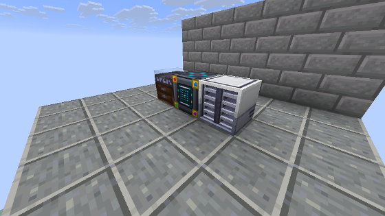

---
navigation:
  parent: index.md
  title: Поставщик шаблонов самоцветов
  icon: ae2apotheotic:gem_pattern_provider
  position: 20
categories:
- machines
item_ids:
- ae2apotheotic:gem_pattern_provider
---

# Апофеотический поставщик шаблонов для самоцветов

<Row gap="20">
  <BlockImage id="ae2apotheotic:gem_pattern_provider" scale="8" />
</Row>

<ItemLink id="ae2apotheotic:gem_pattern_provider" /> напрямую связывает вашу МЭ-сеть с **Шкатулкой самоцветов** (Gem Case) из мода Apotheosis, полностью автоматизируя улучшение чистоты кристаллов и их измельчение в пыль.

Как и стандартные поставщики шаблонов AE2, этот блок является полноценным узлом МЭ-сети: требует 1 канал, подключается кабелем или вплотную к другим устройствам сети с любой стороны и передаёт все загруженные рецепты процессорам автокрафта.

 

## Правильная установка

1. Разместите **Апофеотический поставщик шаблонов** вплотную к **Шкатулке самоцветов** (к любой её грани).
2. Подключите поставщик к вашей МЭ-сети флюиксовым кабелем.
3. В интерфейсе поставщика статус шкатулки загорится зелёным: **«Шкатулка: подключена»**.

 

 

## Как работает автокрафт

Когда игрок заказывает изготовление самоцвета в терминале:
1. **Улучшение чистоты:** Поставщик аккуратно переносит два исходных кристалла и требуемые материалы прямо в инвентарь шкатулки. Он запускает операцию огранки, забирает готовый самоцвет повышенной чистоты и моментально возвращает его в МЭ-сеть.
2. **Измельчение в пыль:** Кристаллы перемалываются в **Пыль самоцветов** по строгому гарантированному курсу. Эта операция выполняется внутри самого поставщика и не требует наличия шкатулки.

> [!NOTE]
> Следите за тем, чтобы шкатулка не была переполнена другими камнями и её слоты материалов были свободны.

 

## Интерфейс по категориям

### 1. Поиск и сетка самоцветов
* Поле поиска фильтрует самоцветы по названию; правый клик очищает его.
* **Все / Занятые** — показать все самоцветы или только те, где уже есть шаблоны.
* В сетке сначала идёт **Массовое дробление**, затем все самоцветы (9 × 3, прокрутка колесом мыши или ползунком).
* Полоска внизу иконки показывает, сколько слотов категории занято (зелёная — все).
* Индикаторы справа сверху: сеть (**N**), шкатулка для самоцветов (**G**) и справка (**i**).

### 2. Категория самоцвета
У каждого самоцвета шесть слотов:
* **I:** Расколотый → Сколотый
* **II:** Сколотый → Дефектный
* **III:** Дефектный → Обычный
* **IV:** Обычный → Безупречный
* **V:** Безупречный → Идеальный
* **Пыль:** дробление именно этого самоцвета (шаблоны дробления «Этот»).

В пустых слотах полупрозрачно показан результат. Ступени ниже минимальной чистоты самоцвета перечёркнуты — их не бывает.

### 3. Массовое дробление
27 свободных слотов под любые шаблоны дробления (точный самоцвет, любой самоцвет одной чистоты, любой самоцвет).

### 4. Умная раскладка (Shift+клик)
Shift+клик по шаблону в инвентаре — поставщик сам положит его в нужный слот и откроет эту категорию.
Шаблоны улучшения идут к своему самоцвету, дробление «Этот» — в слот пыли самоцвета (или в массовое, если занят),
остальное дробление — в массовое дробление.

> [!NOTE]
> Так как шаблоны разложены по самоцветам, этот поставщик **не** показывается в терминале доступа к шаблонам.
> Шаблоны хранятся по ID самоцвета, поэтому добавление или удаление самоцветов их не перемешивает.

 

## Рецепт создания

<RecipeFor id="ae2apotheotic:gem_pattern_provider" />
