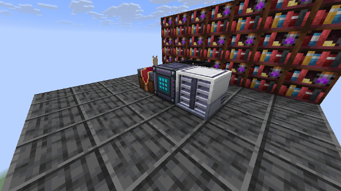

---
navigation:
  parent: ae2apotheotic/index.md
  title: Infusion Pattern Provider
  icon: ae2apotheotic:infusion_pattern_provider
  position: 30
categories:
- machines
item_ids:
- ae2apotheotic:infusion_pattern_provider
---

# Apotheotic Infusion Pattern Provider

<Row gap="20">
  <BlockImage id="ae2apotheotic:infusion_pattern_provider" scale="8" />
</Row>

The <ItemLink id="ae2apotheotic:infusion_pattern_provider" /> brings full ME autocrafting automation to **Apotheosis Enchanting Table Infusion** recipes (such as Infused Dragon's Breath, high-tier Tomes, and specialized bookshelves).

It acts as a standard ME network device: requires 1 channel, connects via cable from any side, appears in the Pattern Access Terminal, and holds 9 specialized <ItemLink id="ae2apotheotic:infusion_pattern" /> cards.

 

## Physical Setup

1. Place the **Apotheotic Infusion Pattern Provider** directly adjacent to an enchanting table:
   * **Raven's Enchanting Table** (recommended): The table uses the exact stats stored inside the encoded pattern card.
   * **Standard Apothic Enchanting Table:** Stats are determined by bookshelves surrounding the table. Crafting jobs execute only if surrounding shelves meet or exceed the required Eterna, Quanta, and Arcana.
2. Connect the provider to your ME network with an ME Cable.
3. The GUI will indicate **"Table: Raven"** (green) or **"Table: shelf stats"** (yellow).

 

 

## How Autocrafting Works

When an infusion craft is requested from the ME network:
1. The provider supplies the input item and 3x Lapis Lazuli blocks/pieces required by the recipe.
2. The provider automatically deducts the required amount of experience.
3. Once complete, the infused result is instantly retrieved and sent back into the ME network.

 

## Experience (XP) Handling & 3-Tier Priority

Enchanting table infusions require experience points based on the recipe's Eterna cost (`20 mB = 1 XP point`). The provider uses a robust 3-tier priority system:

### 1. ME Network Fluid Storage (First Priority)
* The provider queries the connected ME network's fluid storage for liquid experience tagged with `c:experience` or `neoforge:experience`.
* If liquid experience is available in ME fluid storage cells or connected storage buses, the provider extracts it directly using network energy!
* Storing your liquid XP in the ME system provides seamless, fully hands-free infusion autocrafting.

### 2. Internal XP Buffer
* If ME network XP is insufficient or unavailable, experience is paid from the provider's internal buffer (default capacity: 10,000 points).
* Manageable in the GUI via **"+1 lvl"**, **"+All"**, and **"Take"** buttons.
* Fluid pipes can also pump liquid experience directly into the block from any face.

### 3. Adjacent Fluid Tanks
* If more experience is still needed, the provider automatically extracts liquid experience from adjacent physical tanks (such as the **Experience Holder** from **Just Dire Things**).

> [!TIP]
> Experience transactions are completely atomic. If crafting inputs or table conditions are interrupted, no experience or materials are ever leaked or lost.

 

## Crafting Recipe

<RecipeFor id="ae2apotheotic:infusion_pattern_provider" />
