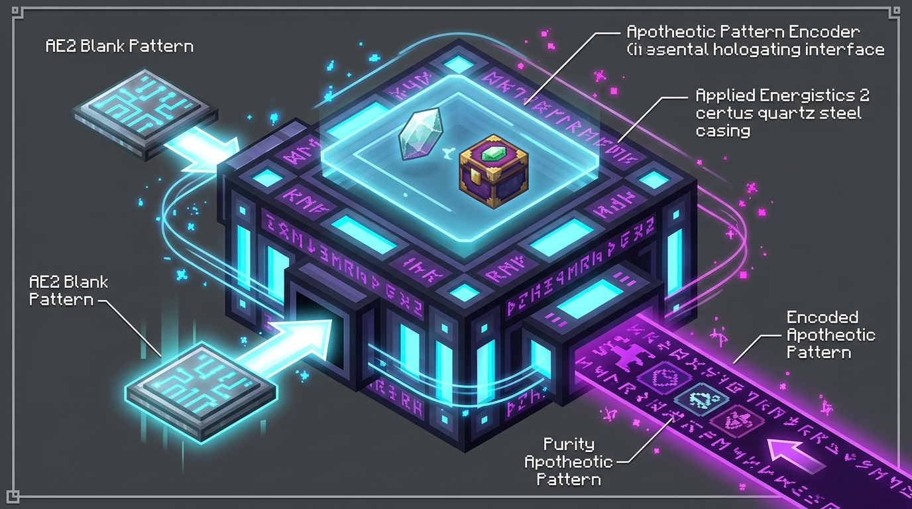

---
navigation:
  parent: ae2apotheotic/index.md
  title: Pattern Encoder
  icon: ae2apotheotic:pattern_encoder
  position: 10
categories:
- machines
item_ids:
- ae2apotheotic:pattern_encoder
---

# Apotheotic Pattern Encoder

<Row gap="20">
  <BlockImage id="ae2apotheotic:pattern_encoder" scale="8" />
</Row>

The <ItemLink id="ae2apotheotic:pattern_encoder" /> is the central planning and encoding terminal for all Apotheosis autocrafting operations. Standard AE2 pattern encoding terminals cannot handle gem cutting recipes, purity progression, or enchanting table stat requirements. The Apotheotic Pattern Encoder solves this by generating specialized pattern cards understood by our Pattern Providers.

 

## Interface Layout

The interface is widened to 210px for clean, readable recipe details and contains:

1. **Top Mode Tabs:** Switch between **Gem Upgrade**, **Gem Crushing**, and **Table Infusion**.
2. **Sample Slot** (left): Place a sample gem or item to inspect available cutting/crushing/infusion recipes.
3. **Blank Pattern Slot** (bottom-left): Insert standard AE2 Blank Patterns.
4. **Encoded Output Slot** (bottom-right): Holds the completed encoded pattern card.
5. **Main Encoding Area** (center): Controls for purity tiers, material choices, or enchanting stats, followed by the **Encode** button.

 

 

## Mode 1: Gem Upgrades (Gem Case)

This mode encodes recipes for upgrading gem purity through an adjacent Gem Case (`2x Gems + Materials → 1x Next Purity Gem`).

1. Insert any gem into the sample slot. The starting purity tier defaults to the sample gem's purity.
2. Use the navigation buttons (`<` and `>`) to adjust the starting purity if desired.
3. If an Apotheosis cutting recipe provides multiple material options (for example, *3 Arcane Shards* **or** *1 Tattered Cloth*), choose your preferred variant using the arrow buttons below the material slots.
4. Click **Encode** to write an <ItemLink id="ae2apotheotic:gem_upgrade_pattern" />.

### Power Feature: Shift + Encode (Chain Encoding)

Holding **Shift** while clicking **Encode** automatically generates the complete upgrade chain from the starting purity all the way up to **Perfect** purity!
* Each tier consumes one blank pattern from the slot and deposits the encoded pattern straight into your inventory.
* When all 5 patterns of the chain are placed into an <ItemLink id="ae2apotheotic:gem_pattern_provider" />, the ME network can calculate the exact amounts of Cracked gems, dust, and materials needed to craft a Perfect gem on demand.

 

## Mode 2: Gem Crushing (Gem Dust)

This mode encodes patterns to smash gems into **Gem Dust**. Autocrafting guarantees the minimum threshold matching native Apotheosis salvaging recipes (`apotheosis:salvaging/gem_dust`), ensuring autocrafting is balanced and never more profitable than manual salvaging:

* **Cracked:** 1 Gem Dust
* **Chipped:** 1 Gem Dust
* **Flawed:** 2 Gem Dust
* **Normal:** 3 Gem Dust
* **Flawless:** 4 Gem Dust
* **Perfect:** 5 Gem Dust

### Filter Options

Toggle the crushing filter mode using the central button:
* **"Only this gem" (Exact):** Encodes crushing for that specific gem type and purity.
* **"Any — <Purity>":** Matches any gem of the selected purity tier (perfect for bulk recycling low-tier gems).
* **"Any gem":** Matches any gem regardless of type or purity (use with caution so valuable gems are not accidentally crushed).

Click **Encode** to produce an <ItemLink id="ae2apotheotic:gem_crush_pattern" />.

 

## Mode 3: Table Infusion

This mode automates enchanting table infusion recipes (e.g. Infused Dragon's Breath, special bookshelves):

1. Place the item to be infused into the sample slot.
2. If multiple infusion recipes exist, select the target recipe using the top navigation arrows.
3. Configure the required enchanting stats:
   * **Eterna** (max power level)
   * **Quanta** (variance)
   * **Arcana** (rarity)
   * Use `-` and `+` to adjust values (hold **Shift** for ±10).
4. **Auto Button:** Click **Auto** to automatically populate the exact minimum requirements for the recipe!
5. The interface verifies recipe match and calculates the exact liquid XP cost.
6. Click **Encode** to write an <ItemLink id="ae2apotheotic:infusion_pattern" /> (`Item + 3x Lapis Lazuli + XP → Result`).

 

## Crafting Recipe

<RecipeFor id="ae2apotheotic:pattern_encoder" />
